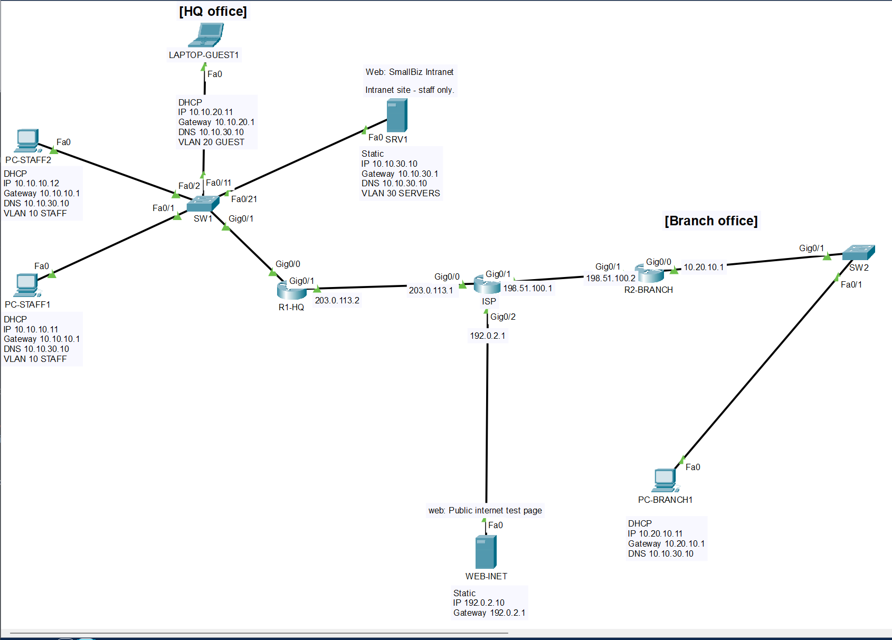
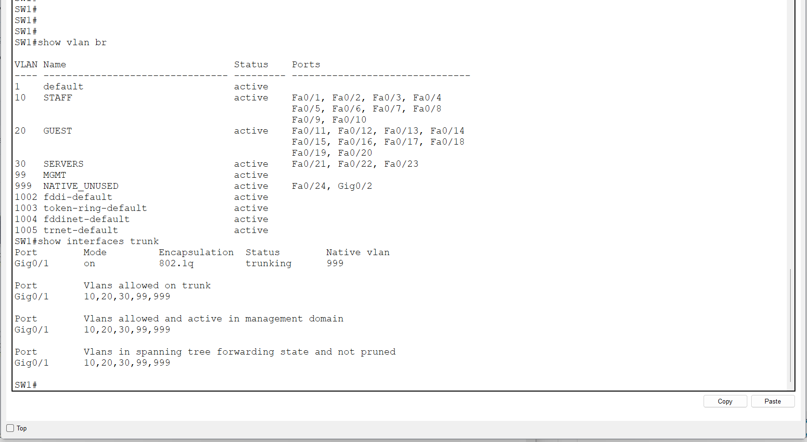
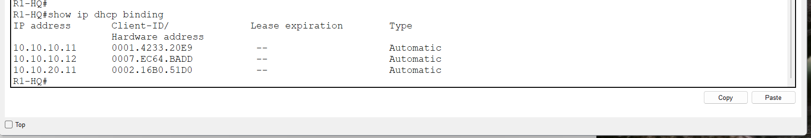
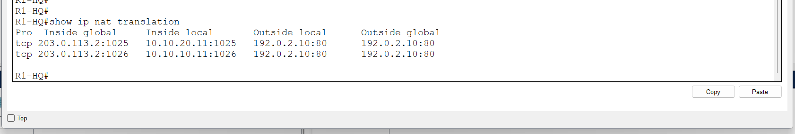
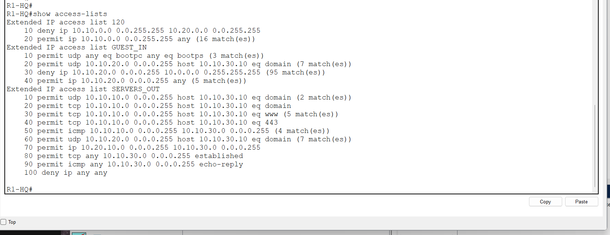
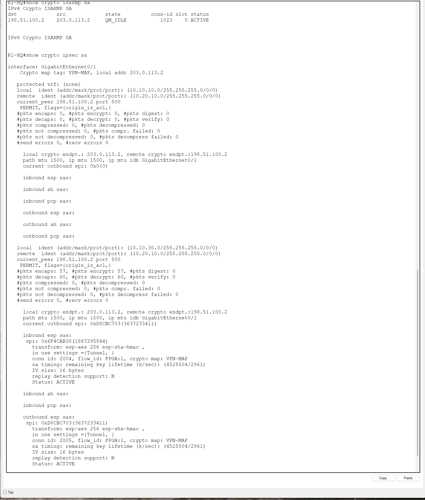
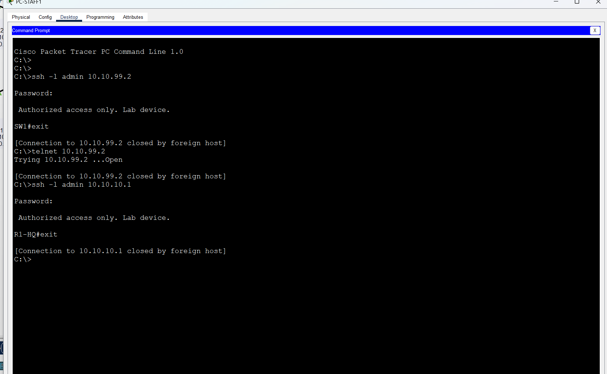

# Small Business Network Design

> **Lab project** built in Cisco Packet Tracer. All addresses are private (RFC 1918) or reserved documentation ranges (RFC 5737), and all passwords and keys are replaced with `<PLACEHOLDERS>`. No real systems or networks were involved.



## Goal

Design, build and test a network for a small office with a branch location. This project demonstrates:

- **Segmentation** with VLANs for staff, guests, servers and management
- **Routing between VLANs** with router-on-a-stick (802.1Q trunk)
- **DHCP** and an internal **DNS** server
- **Firewall rules** (extended ACLs) so guests get internet only and servers expose only the services they offer
- **NAT/PAT** for internet access
- A **site-to-site IPsec VPN** between HQ and the branch
- **Device hardening**: SSH only, restricted to the staff network

I built the whole network twice, from an empty file, to practice the configuration and troubleshooting.

## Lab setup

**Tool:** Cisco Packet Tracer 8.x

| Device | Model | Role |
|---|---|---|
| R1-HQ | ISR 2911 | HQ router: inter-VLAN routing, DHCP, ACL firewall, NAT, VPN |
| SW1 | Catalyst 2960 | HQ access switch with VLANs |
| SRV1 | Server | Internal DNS and intranet web server |
| PC-STAFF1, PC-STAFF2 | PC | Staff workstations |
| LAPTOP-GUEST1 | Laptop | Guest device |
| ISP | ISR 2911 | Simulated internet provider |
| WEB-INET | Server | Simulated public website (www.example.com) |
| R2-BRANCH | ISR 2911 | Branch router: DHCP, NAT, VPN |
| SW2 | Catalyst 2960 | Branch switch |
| PC-BRANCH1 | PC | Branch workstation |

### IP plan

Addressing scheme: `10.<site>.<vlan>.0/24`. Site 10 = HQ, site 20 = branch, and the third octet matches the VLAN ID, so any address shows where a device is.

**HQ VLANs**

| VLAN | Name | Subnet | Gateway (R1) | Addressing | Switch ports |
|---|---|---|---|---|---|
| 10 | STAFF | 10.10.10.0/24 | 10.10.10.1 | DHCP .11–.254 | Fa0/1–10 |
| 20 | GUEST | 10.10.20.0/24 | 10.10.20.1 | DHCP .11–.254 | Fa0/11–20 |
| 30 | SERVERS | 10.10.30.0/24 | 10.10.30.1 | Static | Fa0/21–23 |
| 99 | MGMT | 10.10.99.0/24 | 10.10.99.1 | Static | SVI only |
| 999 | NATIVE_UNUSED | — | — | — | Trunk native VLAN + unused ports |

**Branch and WAN**

| Network | Subnet | Addresses |
|---|---|---|
| Branch LAN | 10.20.10.0/24 | Gateway 10.20.10.1, DHCP .11–.254 |
| R1-HQ ↔ ISP | 203.0.113.0/30 | R1 .2, ISP .1 |
| R2-BRANCH ↔ ISP | 198.51.100.0/30 | R2 .2, ISP .1 |
| ISP ↔ WEB-INET | 192.0.2.0/24 | ISP .1, WEB-INET .10 |

**Static addresses and DNS**

| Device / record | Address |
|---|---|
| SRV1 | 10.10.30.10 (gateway 10.10.30.1) |
| SW1 management (VLAN 99) | 10.10.99.2 (gateway 10.10.99.1) |
| `intranet.smallbiz.lab` (A record) | 10.10.30.10 |
| `www.example.com` (A record) | 192.0.2.10 |

### Cabling

| From | To |
|---|---|
| PC-STAFF1 / PC-STAFF2 | SW1 Fa0/1 / Fa0/2 |
| LAPTOP-GUEST1 | SW1 Fa0/11 |
| SRV1 | SW1 Fa0/21 |
| SW1 Gig0/1 | R1-HQ Gig0/0 (trunk) |
| R1-HQ Gig0/1 | ISP Gig0/0 |
| ISP Gig0/1 | R2-BRANCH Gig0/1 |
| ISP Gig0/2 | WEB-INET Fa0 |
| R2-BRANCH Gig0/0 | SW2 Gig0/1 |
| PC-BRANCH1 | SW2 Fa0/1 |

## Steps

Full sanitized configs are in [`configs/`](configs/). Each step was tested before moving on.

### 1. Topology and security license

Placed and cabled all devices, then enabled the `securityk9` license on R1-HQ and R2-BRANCH (required for the IPsec commands) and reloaded them.

```
license boot module c2900 technology-package securityk9
```

### 2. VLANs and trunk (SW1)

Created VLANs 10, 20, 30, 99 and 999, assigned access ports with PortFast, and configured Gig0/1 as a trunk to R1.

```
interface GigabitEthernet0/1
 switchport mode trunk
 switchport trunk native vlan 999
 switchport trunk allowed vlan 10,20,30,99,999
 switchport nonegotiate
```

Security choices: native VLAN moved off VLAN 1 (prevents VLAN hopping), DTP disabled (`nonegotiate`), and unused ports shut down and parked in VLAN 999.



### 3. Router-on-a-stick (R1-HQ)

One subinterface per VLAN, each acting as that VLAN's default gateway.

```
interface GigabitEthernet0/0.10
 encapsulation dot1Q 10
 ip address 10.10.10.1 255.255.255.0
!
interface GigabitEthernet0/0.999
 encapsulation dot1Q 999 native
```

### 4. DHCP and DNS

R1 serves DHCP to the Staff and Guest VLANs. The router chooses the pool by the subinterface a request arrives on, so each VLAN gets its own range.

```
ip dhcp excluded-address 10.10.10.1 10.10.10.10
ip dhcp pool STAFF
 network 10.10.10.0 255.255.255.0
 default-router 10.10.10.1
 dns-server 10.10.30.10
```

SRV1 got a static IP, two DNS A records and an intranet page. Unused services (FTP and others) were turned off to reduce the attack surface.



### 5. Internet access: ISP, default route and NAT/PAT

The ISP router has no routes to private (10.x) networks, like a real ISP. R1 has a default route to the ISP and translates HQ traffic to its public address.

```
ip route 0.0.0.0 0.0.0.0 203.0.113.1
!
access-list 120 deny   ip 10.10.0.0 0.0.255.255 10.20.0.0 0.0.255.255
access-list 120 permit ip 10.10.0.0 0.0.255.255 any
ip nat inside source list 120 interface GigabitEthernet0/1 overload
```

The `deny` line is a **NAT exemption**: HQ ↔ branch traffic keeps its private addresses so it can match the VPN.



### 6. Firewall rules (ACLs)

**Guest VLAN: internet only** (inbound on G0/0.20)

```
ip access-list extended GUEST_IN
 permit udp any eq 68 any eq 67
 permit udp 10.10.20.0 0.0.0.255 host 10.10.30.10 eq 53
 deny   ip 10.10.20.0 0.0.0.255 10.0.0.0 0.255.255.255
 permit ip 10.10.20.0 0.0.0.255 any
```

The DHCP line must come first and use `any`, because a new client sends from 0.0.0.0.

**Server VLAN: only the services offered** (outbound on G0/0.30)

```
ip access-list extended SERVERS_OUT
 permit udp 10.10.10.0 0.0.0.255 host 10.10.30.10 eq 53
 permit tcp 10.10.10.0 0.0.0.255 host 10.10.30.10 eq 53
 permit tcp 10.10.10.0 0.0.0.255 host 10.10.30.10 eq 80
 permit tcp 10.10.10.0 0.0.0.255 host 10.10.30.10 eq 443
 permit icmp 10.10.10.0 0.0.0.255 10.10.30.0 0.0.0.255
 permit udp 10.10.20.0 0.0.0.255 host 10.10.30.10 eq 53
 permit ip 10.20.10.0 0.0.0.255 10.10.30.0 0.0.0.255
 permit tcp any 10.10.30.0 0.0.0.255 established
 permit icmp any 10.10.30.0 0.0.0.255 echo-reply
 deny   ip any any
```



*Taken before the VPN was built, so the branch line (70) and the NAT exemption show no hits yet.*

### 7. Site-to-site IPsec VPN

Configured on both routers as mirror images. R1-HQ side:

```
crypto isakmp policy 10
 encryption aes 256
 hash sha
 authentication pre-share
 group 5
 lifetime 86400
crypto isakmp key <PRE-SHARED-KEY> address 198.51.100.2
!
crypto ipsec transform-set VPN-SET esp-aes 256 esp-sha-hmac
!
access-list 110 permit ip 10.10.10.0 0.0.0.255 10.20.10.0 0.0.0.255
access-list 110 permit ip 10.10.30.0 0.0.0.255 10.20.10.0 0.0.0.255
!
crypto map VPN-MAP 10 ipsec-isakmp
 set peer 198.51.100.2
 set transform-set VPN-SET
 match address 110
!
interface GigabitEthernet0/1
 crypto map VPN-MAP
```

- **Phase 1 (ISAKMP)** authenticates the peers with the pre-shared key and secures the negotiation.
- **Phase 2 (IPsec/ESP)** encrypts the data that matches ACL 110.
- The guest subnet is deliberately left out of ACL 110, so guests can never use the tunnel.



### 8. Management hardening

On R1-HQ, R2-BRANCH and SW1: hashed `enable secret`, a local admin account, RSA 2048 keys, SSH version 2 only, Telnet disabled, a login banner, idle timeouts, and `access-class` so only the staff subnet (plus the branch LAN on R2) can open a session.

```
username admin privilege 15 secret <ADMIN-PASSWORD>
crypto key generate rsa general-keys modulus 2048
ip ssh version 2
access-list 10 permit 10.10.10.0 0.0.0.255
line vty 0 15
 login local
 transport input ssh
 access-class 10 in
```



## Findings

### Verification results

| # | Test | From | Result |
|---|---|---|---|
| 1 | Staff and guests get DHCP from their own pools | PCs / laptop | ✅ 10.10.10.11–.12 and 10.10.20.11 |
| 2 | Inter-VLAN routing | PC-STAFF1 → SRV1 | ✅ Replies, TTL 127 (one router hop) |
| 3 | DNS + intranet by name | PC-STAFF1 | ✅ `intranet.smallbiz.lab` loads |
| 4 | Internet **before** NAT | PC-STAFF1 → 192.0.2.10 | ❌ Timed out (expected) |
| 5 | Internet **after** NAT | Staff and guest browsers | ✅ `www.example.com` loads |
| 6 | Guest → intranet | LAPTOP-GUEST1 | ❌ Blocked (expected) |
| 7 | Guest → staff PC / server | LAPTOP-GUEST1 | ❌ Blocked (expected) |
| 8 | Staff → intranet, internet, server ping | PC-STAFF1 | ✅ All work |
| 9 | Branch → HQ server over VPN | PC-BRANCH1 | ✅ Replies after negotiation |
| 10 | HQ staff → branch PC over VPN | PC-STAFF1 | ✅ 10/10 |
| 11 | Branch → intranet by name over VPN | PC-BRANCH1 | ✅ Page loads |
| 12 | Staff → SSH to SW1 and R1-HQ | PC-STAFF1 | ✅ |
| 13 | Staff → Telnet to SW1 | PC-STAFF1 | ❌ Refused (expected) |
| 14 | Guest → SSH to SW1 | LAPTOP-GUEST1 | ❌ Timed out (expected) |
| 15 | Branch → SSH to R2-BRANCH | PC-BRANCH1 | ✅ |

### What the evidence shows

- **NAT is required.** Before NAT, a staff ping to the public web server timed out. The packet reached the server, but the reply was addressed to 10.10.10.11 and the ISP has no route to private addresses. After PAT, two hosts shared the single public address 203.0.113.2, told apart by source port (1025 and 1026).
- **The guest firewall works.** The guest deny line collected 95 hits during testing, while the guest DHCP (3), DNS (7) and internet (5) lines also matched. The guest's DNS lookup for the intranet *succeeded* but the web request was blocked, so the rules filter by port and destination, not just by name.
- **Defense in depth.** The same 7 guest DNS queries matched both GUEST_IN and SERVERS_OUT: two independent checks on the same traffic.
- **Blocked traffic gets a reply.** Blocked guest pings returned "Destination host unreachable" from the gateway (10.10.20.1). That tells an attacker a filter exists. On real IOS, `no ip unreachables` on the guest interface would make the router drop silently. Packet Tracer did not support it on the subinterface, so it stays a recommendation.
- **The VPN is invisible to the ISP.** Pings across the tunnel showed TTL 126: two router hops (R1 and R2). The ISP router only handled the outer encrypted packet, so it doesn't appear.
- **The tunnel carries real traffic.** `show crypto isakmp sa` showed `QM_IDLE / ACTIVE`, and `show crypto ipsec sa` showed 57 packets encrypted and 60 decrypted with `esp-aes 256 esp-sha-hmac`, with an active SA in each direction.

### Troubleshooting 1: the VPN would not come up (round 1)

**Symptoms**
- Branch pings to the HQ server returned "Destination host unreachable" from the ISP (198.51.100.1).
- `show crypto isakmp sa` was empty, and the encaps/decaps counters stayed at 0.

**Investigation**
- The crypto settings matched on both routers, R2's license was active, and the two routers could ping each other.
- A tunnel started from the HQ side **did** come up (`QM_IDLE`), but pings still failed.
- `show ip nat translations` on R2 showed branch traffic to 10.10.30.10 being **translated** to 198.51.100.2.
- `show access-lists 120` showed the NAT exemption line with **0 matches**.

**Root cause:** a wildcard typo in R2's NAT exemption.

```
deny ip 10.20.0.0 0.0.0.255 10.10.0.0 0.0.255.255   ← wrong: matches only 10.20.0.x
deny ip 10.20.0.0 0.0.255.255 10.10.0.0 0.0.255.255 ← correct: matches 10.20.x.x
```

NAT runs before encryption. Once the traffic was translated, it no longer matched the crypto ACL and went out unencrypted, where the ISP dropped it.

**Fix**
1. Rebuilt ACL 120 with the correct wildcard.
2. Cleared the NAT translations.
3. Sent more traffic (`ping -n 20`) so the tunnel could renegotiate. Seven pings timed out while leftover SAs were replaced, then all replies came back.

In the second build the VPN came up with a single timeout.

**Extra insight from round 2:** with the correct exemption, the pre-VPN branch ping showed "Request timed out" instead of "unreachable". The ISP's error message was addressed to the private address 10.20.10.11, which it can't route. So the round 1 message "unreachable from 198.51.100.1" was itself a clue: the packet had left with a translated source address.

### Troubleshooting 2: SSH to SW1 rejected the correct password (round 2)

**Symptoms**
- SSH to SW1 prompted for a password three times, then closed the connection.
- The same password worked on the console, and SSH to both routers worked.

**Root cause:** the vty lines had `login` instead of `login local`.
- `login` checks a line password, and none was set.
- `login local` checks the local username database, which the console was already using.

**Fix:** re-entered the vty block with `login local`.

## Fix or recommendation

| Area | Recommendation for a real deployment |
|---|---|
| Firewall | Replace stateless ACLs with a stateful firewall (zone-based firewall, ASA, pfSense, FortiGate), so return traffic is tracked automatically. |
| VPN | Use IKEv2, AES-GCM, SHA-256 or better and DH group 14+. Use certificates instead of a pre-shared key. The settings here were limited by what Packet Tracer supports. |
| Blocked traffic | Disable ICMP unreachables on untrusted interfaces (`no ip unreachables`), so the firewall drops silently. |
| Layer 2 security | Enable DHCP snooping, Dynamic ARP Inspection and port security on access ports. |
| Authentication | Use central authentication (RADIUS/TACACS+) with a local fallback account, so one mistyped local setting can't lock admins out. |
| Logging | Add `log` to deny lines and send syslog to a SIEM (e.g. Splunk). Alert on repeated denies from one host and on failed SSH logins. |
| Guests | Put guests on their own wireless SSID with client isolation. |
| Redundancy | Consider a second internet link or router, since R1 is a single point of failure. |

### Design decisions and tradeoffs

| Decision | Why | Tradeoff |
|---|---|---|
| Router-on-a-stick instead of a Layer 3 switch | Low cost, one device to manage | All inter-VLAN traffic shares one link and one router CPU |
| One router for routing, DHCP, firewall, NAT and VPN | Fits a small office budget | Single point of failure |
| Extended ACLs as the firewall | Built into IOS, no extra hardware | Stateless: replies need manual rules (`established`, `echo-reply`) and there's no application inspection |
| Guests use internal DNS (UDP 53 only) | One DNS server to manage | A public resolver for guests would isolate them further |
| DHCP on the router | Works even if the server is down | Less reporting than a dedicated DHCP server |
| Server ACL lists each allowed service | Only DNS and web are reachable | Every new service needs a new rule |
| Site-to-site VPN over the internet | No leased line needed | Depends on internet quality, and the pre-shared key must be protected |
| Separate NAT and crypto ACLs | Standard IOS design | The two must stay in sync. A one-octet mistake broke the tunnel in this lab. |

## Verification

How each part was confirmed:

| Area | Command or test |
|---|---|
| VLANs and trunk | `show vlan brief`, `show interfaces trunk` (Gig0/1 trunking, native 999) |
| Inter-VLAN routing | `show ip interface brief` (all subinterfaces up/up), ping across VLANs |
| DHCP | `show ip dhcp binding`, `ipconfig` on clients |
| DNS and web | `nslookup`, browser tests by name |
| NAT | Ping before and after NAT, `show ip nat translations`, `show access-lists 120` |
| Firewall | Allowed and blocked tests from staff and guest, then `show access-lists` match counters |
| VPN | Pings in both directions, `show crypto isakmp sa`, `show crypto ipsec sa` |
| SSH | SSH and Telnet attempts from staff, guest and branch |

## Lessons learned

- **One wildcard bit can break a VPN.** `0.0.0.255` vs `0.0.255.255` decided whether traffic entered the tunnel. I now double-check every wildcard as I type it.
- **Order of operations matters.** NAT happens before encryption, so VPN traffic must be exempt from NAT, and the NAT and crypto ACLs have to agree.
- **Counters and tables tell the story.** NAT translations and ACL hit counts found the VPN bug. Error messages also mean something: "unreachable from the ISP" vs "timed out" showed which source address a packet used.
- **Give tunnels time.** IPsec negotiates on demand, so the first pings fail. Short pings can make a working tunnel look broken, so I used `ping -n 20`.
- **Small keywords matter.** `login` vs `login local` was the only difference between SSH working and failing.
- **ACLs are stateless.** Return traffic needs its own rules, which is why a stateful firewall is the next step for a real network.
- **Rebuilding helps.** The second build went much faster, and the VPN worked first time because I knew where the mistakes happen.

## Publishing checklist

- [x] Removed secrets and identifying details (passwords and keys are `<PLACEHOLDERS>`, no password hashes or serial numbers)
- [x] Added a README with setup and configuration details
- [x] Checked screenshots (cropped, no usernames, file paths or secrets)
- [x] Clearly labeled as a lab project
- [x] `.pkt` files **not** uploaded (they store the VPN key in plain text)
